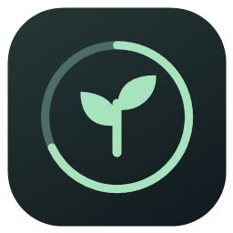
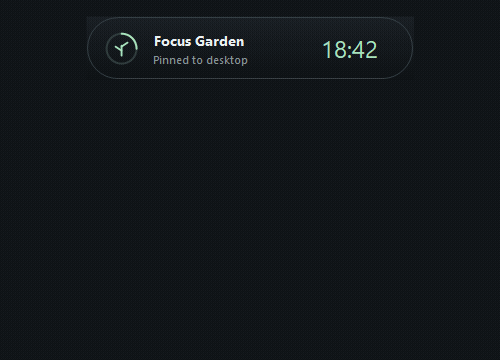
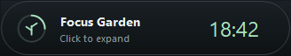
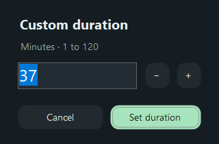
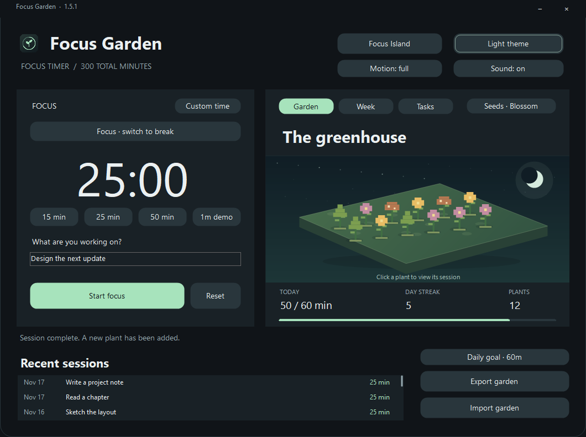
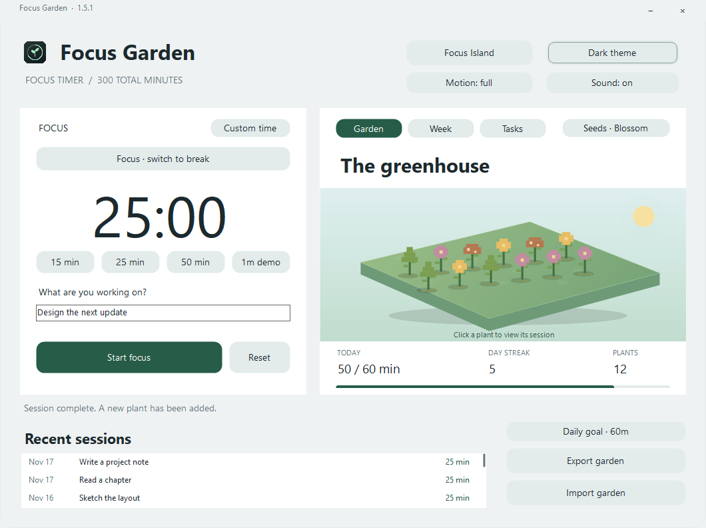
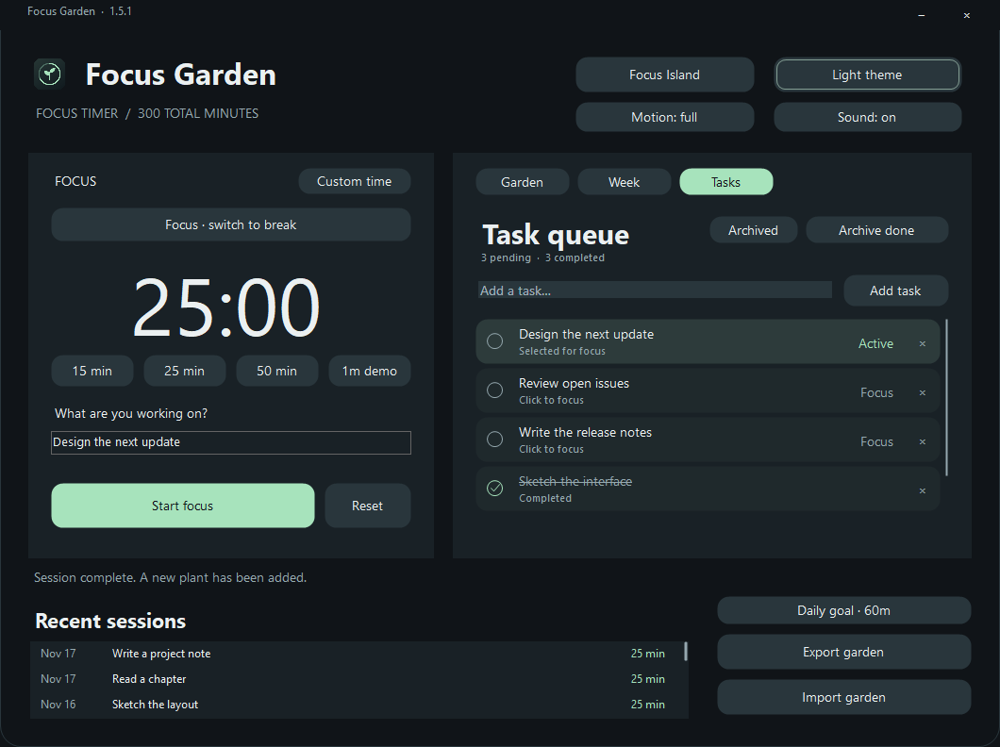
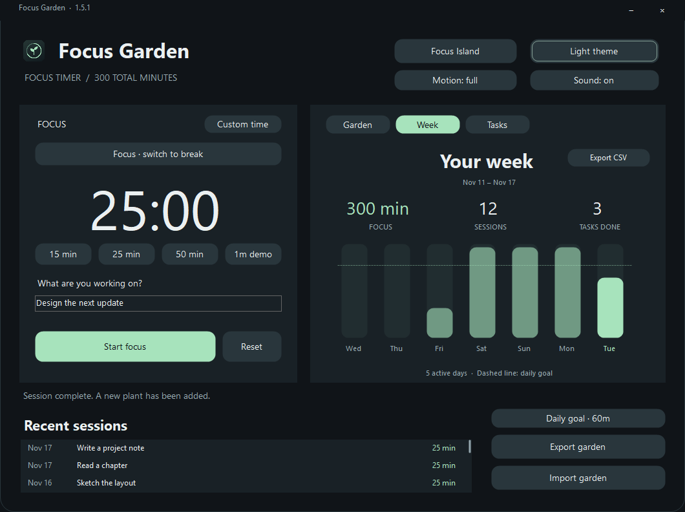

<p align="center"></p>
<h1 align="center">Focus Garden</h1>
<p align="center">A Windows focus timer with an auto-hiding desktop island.</p>
<p align="center"><a href="https://github.com/Sssixstyninesss/focus-garden/releases/latest">Download for Windows</a> · <a href="#controls">Controls</a> · <a href="#build">Build from source</a></p>

<p align="center"></p>

*Animation rendered by the application with sample data.*

The island shows your timer above other windows. Move the pointer away and it fades out. Hover over its previous position to bring it back. Click to expand the controls or drag the background to move it.

Completed focus sessions add plants to a local garden. Open the full window to name a task, view your sessions, change the theme, or export a backup.

The main window has three views: **Garden**, **Week**, and **Tasks**. The timer remains available while switching views.

## Install

Download **FocusGarden.exe** from [Releases](https://github.com/Sssixstyninesss/focus-garden/releases/latest) and place it in a writable folder, including a folder on D:. No installer or administrator access is required.

Requires Windows 10 or 11 with .NET Framework 4.8. The executable is not digitally signed. No browser, Node.js, or additional packages are needed to run it.

To update, quit through the tray menu and replace the executable. Keep the adjacent `data` folder to preserve your garden.

## Features

- Auto-hide after 1.8 seconds away from the island; hover to reveal.
- Size and opacity transitions with time-based easing; animated button hover states.
- Pin mode to keep the island visible.
- Task editing directly inside the expanded island.
- A persistent task queue with selection, completion, reopening, and archiving. Choose a queued task from the arrow beside the island's task field.
- A seven-day overview of focus minutes, sessions, and completed tasks. Click a day to inspect its sessions or export the week as CSV.
- Custom sessions from 1 to 120 minutes, available through the `35m +` button or **Custom time** in the garden. The custom button shows your last chosen duration.
- Saved island position, pin state, sound, and motion preferences. Positions are kept within the current monitor's work area when restored.
- Reduced motion mode, with immediate transitions and no decorative animation.
- 15, 25, and 50 minute sessions, a 1 minute demo, and 5 minute breaks.
- Pause, resume, and a completion notification inside the island.
- Dark and light themes for the garden window.
- Four plant designs, session history, JSON import and export.
- A floating garden with day and night scenes, subtle ambient animation, and clickable plants linked to their sessions.
- A daily focus goal and a day streak. Use **Daily goal** to cycle through 30, 60, 90, and 120 minutes.
- Choose the next plant from **Seeds**: sunflower, pine, blossom, mushroom, or a random mix.
- Portable storage. No network requests, accounts, telemetry, or subscriptions.

<p align="center"></p>

## Controls

| Action | Control |
| --- | --- |
| Reveal the hidden island | Hover over its previous compact position for about 150 ms |
| Expand or collapse | Click the island background |
| Move | Drag the island background |
| Keep visible | **Pin** in the expanded island |
| Edit the task | Click the task field, or `Ctrl+E` in the island |
| Start or pause from the keyboard | `Ctrl+Enter` in the island |
| Set a custom duration | Custom duration button in the island or **Custom time** in the garden |
| Collapse | **−** or `Esc` |
| Open the garden | **Open garden**, `F2`, or double-click the tray icon |
| Return to the island | **Focus Island** in the garden window |
| Close the garden to the island | **×** or `Alt+F4` in the main window; the timer keeps running |
| Start or pause | Session button; `Space` when the island background has keyboard focus |
| Exit | Right-click the tray icon → **Quit** |

The hidden island is a hidden window, not a transparent overlay: it does not intercept clicks. The app checks the pointer position without capturing the screen or installing a global mouse hook. Opening the garden suspends hover detection until you return to the island. While editing a task or choosing a duration, the island stays visible. A completed session reveals the island for eight seconds, unless the full garden is open.

The tray menu also has a start/pause command. Use **Quit** in the tray to exit the application completely. **Sound** and **Motion** settings are available in the garden window.



## Garden



<details><summary>Light theme</summary>



</details>

Previews are rendered by the application with sample data. The garden displays the most recent 18 plants and 30 sessions; statistics include the full collection. Breaks do not add plants.

Click a plant or history row to view its task, duration, and completion time. Scroll the session list with the mouse wheel or use the arrow and Page Up/Down keys when the list has focus.

A streak counts consecutive local calendar days with at least one completed focus session. Yesterday's streak remains visible until today ends; multiple sessions on the same day count once. The daily goal is a progress indicator, not a requirement for maintaining the streak.

The timer uses a deadline. If you close the app during a session, the elapsed time is accounted for on the next launch. Notifications only run while the app is open. The timer does not monitor whether you are working.

## Tasks and weekly statistics



Add a task in **Tasks**, click its title to select it for focus, and use the circle to mark it done or reopen it. The `×` action archives a task. **Archive done** clears completed tasks from the visible queue while keeping their records for statistics.

Open **Archived** and use `↶` to restore a task. Archiving does not permanently delete its record.

In the task list, use Up/Down to move, Enter to select, Space to toggle completion, and Delete to archive. A task can take several focus sessions; completing a timer does not automatically mark the task done. Pause the timer before changing or completing its active queued task. Editing the selected task in the timer or island also updates its queue title.

The island menu shows up to 20 pending tasks; **Manage tasks** opens the full queue. Up to 200 tasks can remain visible, with 5,000 records stored including archived tasks.



**Week** covers today and the preceding six local calendar days. **Tasks done** counts currently completed tasks by their completion date, including archived records. Reopening a task removes its completion from that count. CSV export contains one row per day with focus minutes, sessions, and completed tasks.

Click a chart day to filter the history below it. Use **All sessions** to return to the recent list.

## Data

Saved in `data/garden.json` beside the executable. `data/garden.json.bak` holds the previous save. Use **Export garden** for a separate backup; **Import garden** merges sessions and tasks. Existing local task state takes precedence when an imported task has the same ID. Repeated imports skip duplicates.

Writes use a temporary file, flush to disk, and replace the previous save. If the primary file is unreadable, the app tries its backup and preserves unreadable originals as `.recovery-*` files. If those originals cannot be moved, automatic writes are disabled and the app asks you to export elsewhere.

Text edits are saved after a short pause in typing; closing the app or starting a session saves immediately.

Existing user-written task names are kept in their original language. The desktop save format is separate from the early web prototype.

## Build

Run from a Windows PowerShell terminal:

```powershell
.\build.ps1
```

The build uses the .NET Framework compiler included with Windows. There are no NuGet dependencies. `FocusGarden.cs` contains the garden and timer; `Island.cs` contains the floating window; `Planning.cs` contains tasks and weekly statistics; `Storage.cs` handles save validation and recovery. The icon is embedded into the executable.

Run the regression and off-screen UI checks:

```powershell
.\test.ps1
```

Tests cover save validation and migration, preference persistence, custom duration input, timer deadlines, task synchronization, pause/resume, selected seeds, streaks, task selection and archiving, keyboard navigation, week boundaries, CSV output, idempotent imports, corrupt and locked files, recovery, auto-hide, hover dwell, reduced motion, and suspension. Test artifacts go into the ignored `work` folder. Preview checks use sample data and do not change your saved garden.

Icon artwork is generated by `tools\IconMaker.cs` at 16–256 px. To regenerate:

```powershell
$compiler = "$env:WINDIR\Microsoft.NET\Framework64\v4.0.30319\csc.exe"
& $compiler /nologo /out:IconMaker.exe /reference:System.Drawing.dll tools\IconMaker.cs
.\IconMaker.exe assets
```

## License

[MIT](LICENSE).
