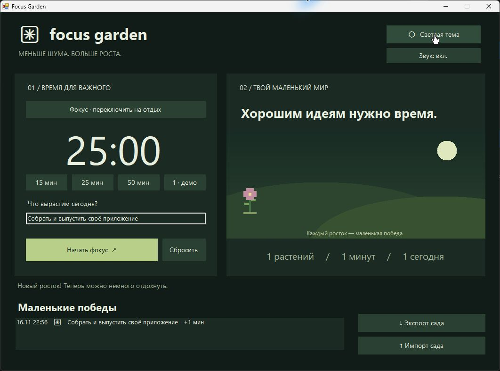

# ✳ Focus Garden Desktop

**Твоё внимание превращается в маленький сад.**

Нативное приложение для Windows: выбери задачу, запусти таймер и получи новое пиксельное растение за завершённую сессию. Без браузера, локального сервера, аккаунта и подписки.

**[Скачать для Windows](https://github.com/Sssixstyninesss/focus-garden/releases/latest)** · **[Сообщить об ошибке](https://github.com/Sssixstyninesss/focus-garden/issues)**



<details>
<summary>Посмотреть светлую тему</summary>


</details>

## Запуск

Скачай и запусти **FocusGarden.exe**. Установка не нужна: файл можно хранить на любом диске. Требуется Windows 10/11 с .NET Framework 4.8 (обычно уже входит в Windows). Приложение не подписано цифровым сертификатом.

1. Выбери длительность и напиши, над чем хочешь поработать.
2. Нажми «Начать фокус» и займись задачей.
3. Дождись ростка. Сделай передышку. Повтори в своём темпе.

## Маленькие детали, которые помогают

- **Тёмная и светлая темы** — выбор сохраняется между запусками.
- **15, 25 или 50 минут фокуса**, минутная демосессия и передышка на 5 минут.
- Пауза, продолжение, подпись задачи и переключаемый звук завершения.
- Четыре вида пиксельных растений, статистика и история последних 30 сессий.
- Сад сохраняется в JSON, есть экспорт, импорт с объединением и резервная копия предыдущего сохранения.
- Таймер учитывает прошедшее время после закрытия приложения: завершённая сессия засчитывается при следующем запуске. Закрытое приложение не воспроизводит уведомления.
- Никаких сетевых запросов, трекеров или обязательных сервисов.

На экране показаны последние 18 растений; статистика учитывает всю коллекцию. Передышки не дают растений. Таймер не контролирует твою активность — это инструмент для собственного ритма.

## Где данные

В папке `data` рядом с приложением: `data\garden.json`. Рядом хранится предыдущая версия `garden.json.bak`. Приложение полностью переносное: храни его в доступной для записи папке, например на D:. Экспортируй сад перед переустановкой Windows. Настольный формат сохранения отличается от ранней веб-версии.

## Собрать самому

Исходник — один файл C#, без NuGet и сторонних зависимостей. Компилятор .NET Framework входит в поддерживаемые системы Windows.

```powershell
powershell -ExecutionPolicy Bypass -File .\build.ps1
```

Можно также открыть исходник в Visual Studio и собрать Windows Forms приложение для .NET Framework 4.8 с ссылкой на `System.Runtime.Serialization`.

## Идеи для вклада

Новые растения, локализация, произвольная длительность и улучшения доступности. Issues и pull requests приветствуются.

## Лицензия

MIT — можно изменять, распространять и использовать в своих проектах с сохранением лицензии.
