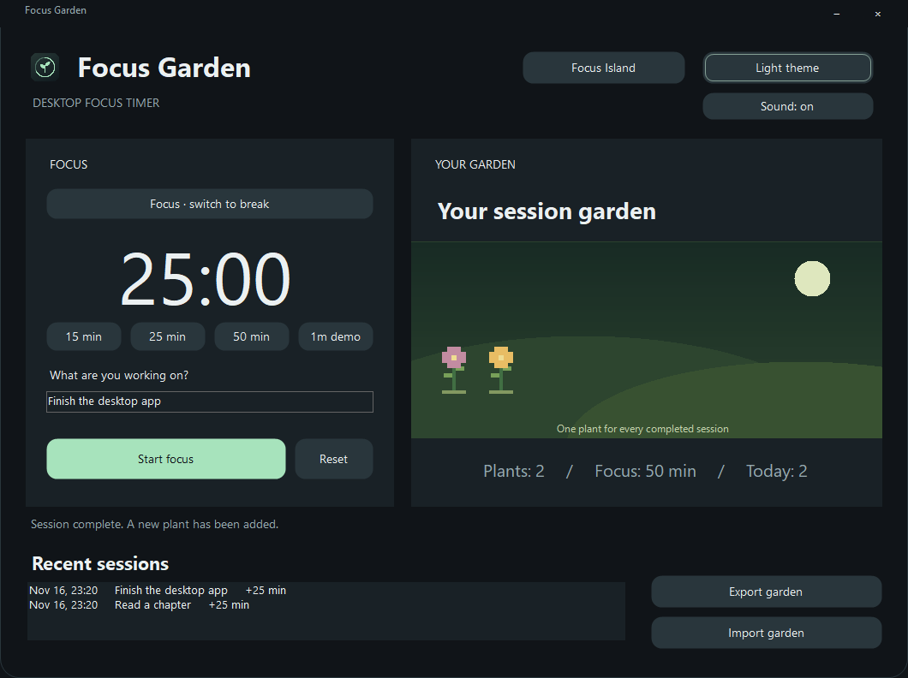
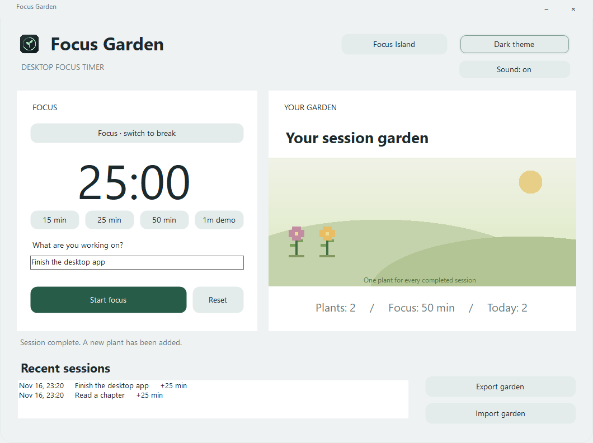

<p align="center"></p>
<h1 align="center">Focus Garden</h1>
<p align="center">A Windows focus timer with an auto-hiding desktop island.</p>
<p align="center"><a href="https://github.com/Sssixstyninesss/focus-garden/releases/latest">Download for Windows</a> · <a href="#controls">Controls</a> · <a href="#build">Build from source</a></p>

<p align="center"></p>

The island shows your timer above other windows. Move the pointer away and it fades out. Hover over its previous position to bring it back. Click to expand the controls or drag the background to move it.

Completed focus sessions add plants to a local garden. Open the full window to name a task, view your sessions, change the theme, or export a backup.

## Install

Download **FocusGarden.exe** from [Releases](https://github.com/Sssixstyninesss/focus-garden/releases/latest) and place it in a writable folder, including a folder on D:. No installer or administrator access is required.

Requires Windows 10 or 11 with .NET Framework 4.8. The executable is not digitally signed. No browser, Node.js, or additional packages are needed to run it.

To update, quit through the tray menu and replace the executable. Keep the adjacent `data` folder to preserve your garden.

## Features

- Auto-hide after 1.8 seconds away from the island; hover to reveal.
- Size and opacity transitions with time-based easing; animated button hover states.
- Pin mode to keep the island visible.
- 15, 25, and 50 minute sessions, a 1 minute demo, and 5 minute breaks.
- Pause, resume, and a completion notification inside the island.
- Dark and light themes for the garden window.
- Four plant designs, session history, JSON import and export.
- Portable storage. No network requests, accounts, telemetry, or subscriptions.

<p align="center"></p>

## Controls

| Action | Control |
| --- | --- |
| Reveal the hidden island | Hover over its previous compact position for about 150 ms |
| Expand or collapse | Click the island background |
| Move | Drag the island background |
| Keep visible | **Pin** in the expanded island |
| Collapse | **−** or `Esc` |
| Open the garden | **Open garden**, `F2`, or double-click the tray icon |
| Return to the island | **Focus Island** in the garden window |
| Start or pause | Session button; `Space` when the island background has keyboard focus |
| Exit | Right-click the tray icon → **Quit** |

The hidden island is a hidden window, not a transparent overlay: it does not intercept clicks. The app checks the pointer position without capturing the screen or installing a global mouse hook. Opening the garden suspends hover detection until you return to the island. A completed session reveals the island for eight seconds, unless the full garden is open.

## Garden



<details><summary>Light theme</summary>



</details>

Previews are rendered by the application with sample data. The garden displays the most recent 18 plants and 30 sessions; statistics include the full collection. Breaks do not add plants.

The timer uses a deadline. If you close the app during a session, the elapsed time is accounted for on the next launch. Notifications only run while the app is open. The timer does not monitor whether you are working.

## Data

Saved in `data/garden.json` beside the executable. `data/garden.json.bak` holds the previous save. Use **Export garden** for a separate backup; **Import garden** merges sessions and skips duplicates.

Existing user-written task names are kept in their original language. The desktop save format is separate from the early web prototype.

## Build

Run from a Windows PowerShell terminal:

```powershell
.\build.ps1
```

The build uses the .NET Framework compiler included with Windows. There are no NuGet dependencies. `FocusGarden.cs` contains the garden and timer, and `Island.cs` contains the floating window, presence state, and controls. The icon is embedded into the executable.

Run the logic and off-screen UI checks:

```powershell
$compiler = "$env:WINDIR\Microsoft.NET\Framework64\v4.0.30319\csc.exe"
& $compiler /nologo /target:exe /out:TestRunner.exe /resource:assets/app.ico,FocusGarden.Icon /resource:assets/app.png,FocusGarden.Mark /reference:System.Windows.Forms.dll /reference:System.Drawing.dll /reference:System.Runtime.Serialization.dll FocusGarden.cs Island.cs
.\TestRunner.exe --self-test
.\TestRunner.exe --render-preview preview
```

Tests cover save validation, timer deadlines, pause/resume, session completion without duplicates, auto-hide timing, hover dwell, pinning, and suspension. Preview checks use sample data and do not change your saved garden.

Icon artwork is generated by `tools/IconMaker.cs` at 16–256 px. To regenerate:

```powershell
& $compiler /nologo /out:IconMaker.exe /reference:System.Drawing.dll tools/IconMaker.cs
.\IconMaker.exe assets
```

## License

[MIT](LICENSE).
